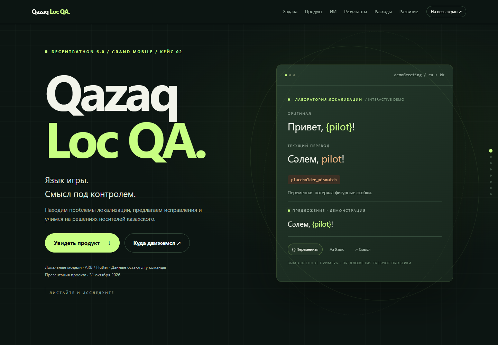
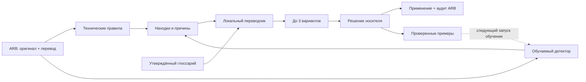

<div align="center">

# Qazaq Loc QA.

**Язык игры. Смысл под контролем.**

Grand Mobile × Decentrathon 6.0 · Кейс 02

[](presentation.html)

### [▶ ОТКРЫТЬ ПРЕЗЕНТАЦИЮ](presentation.html)

**[Открыть локально одним запуском](open_project.cmd)** · **[Запустить проверку ARB](start_project.cmd)** · **[Публичное демо](examples/demo/README.md)**


Анимированная презентация · Интерактивные примеры · Расходы и калькулятор · Дорожная карта

[Продукт](#зачем-это-нужно) · [Архитектура](#как-устроено) · [Результаты](#результаты-и-метрики) · [Развитие](#следующие-этапы) · [Защита](docs/pitch.md)

</div>

## Открыть проект

| Хочу посмотреть | Что открыть после скачивания репозитория |
|---|---|
| **Красивую презентацию в браузере** | [open_project.cmd](open_project.cmd) — двойной щелчок. Откроется [presentation.html](presentation.html). Установка и интернет не нужны. |
| **Проверить свои ARB-файлы** | Положите `intl_ru.arb` и `intl_kk.arb` в `input/`, затем запустите [start_project.cmd](start_project.cmd). Результат — `result/index.html`. Нужен Python; локальный ИИ требует отдельно установленных весов. |
| **Проверить работу без данных организатора** | Инструкция и вымышленные данные в [публичном демо](examples/demo/README.md). |

**На GitHub:** HTML и `.cmd` открываются как исходный код. Скачайте репозиторий через **Code → Download ZIP**, распакуйте и запустите `open_project.cmd`. В macOS/Linux откройте `presentation.html` в браузере. Страница [index.html](index.html) также ведёт в презентацию. Файлы не опубликованы как отдельный сайт.

В презентации: переключение примеров ошибок, навигация по главам, анимированный путь развития и калькулятор полной стоимости. Клавиши **← / →** переключают разделы, **F** включает полный экран. Анимации учитывают системную настройку уменьшения движения.

## Зачем это нужно

В игровой локализации мало перевести слова. Нужно сохранить переменную с именем игрока, уложиться в кнопку, не перепутать игровую «семью» с бытовым контекстом и подобрать казахскую фразу, которая звучит естественно. Разработчику, не знающему языка, трудно увидеть такие проблемы до релиза.

**Qazaq Loc QA превращает ARB-файлы в объяснимую очередь решений.** Разработчик получает ключ, причину и приоритет; переводчик — контекст и предложения; носитель языка — возможность принять вариант, написать свой или отклонить все. Подтверждённые решения становятся данными для следующего цикла обучения.

> **Замысел продукта:** специализированная система, которая учится на проверенных игровых переводах и постепенно сокращает объём ручной проверки новых файлов. Сейчас доступны технический MVP, локальные генераторы переводов и контур обучения детектора. Семантическое качество ещё предстоит подтвердить на независимых данных.

## Что выделяет решение

| Решение | Практическая польза |
|---|---|
| **Детектор и исправитель разделены** | Поиск ошибок и качество предложенного перевода можно оценивать независимо. |
| **Игровой контекст в глоссарии** | Термины согласуются с носителями и игроками; неоднозначное слово не навязывается каждому контексту. |
| **До трёх предложений на строку** | Проверяющий выбирает подходящий вариант или пишет свой. Генерация работает локально. |
| **Неуверенность видна** | Обучаемый детектор различает `error`, `uncertain`, `no_issue`; сомнение остаётся поводом для проверки. |
| **Решения превращаются в обучающие примеры** | В эталон попадают только явно принятые строки; реальные и синтетические ошибки оцениваются отдельно. |
| **У каждого исправления есть след проверки** | Метаданные ARB и финальный аудит показывают, какие изменения подтверждены человеком. |

## Демо за минуту

Для своих файлов в Windows: положите русский и казахский ARB в `input`, откройте `start_project.cmd`, затем смотрите `result/index.html`. Там находятся все строки, сравнение до/после, причины замечаний и варианты перевода. `result/all_data.json` сохраняет полный набор данных, `intl_kk_draft.arb` — черновик, `intl_kk_fixed.arb` — только подтверждённые правки. [Инструкция для входной папки](input/README.txt).

Нужен **Python 3.10+**. Для CLI, HTML-отчёта и тестов достаточно стандартной библиотеки. Модель, GPU, API-ключ и данные организатора для демо не нужны.

```bash
git clone https://github.com/NeNurym/QAForGrandMobile.git
cd QAForGrandMobile
python locqa.py check --source examples/demo/intl_ru.arb --target examples/demo/intl_kk.arb --glossary examples/demo/glossary.csv --suspect-phrases examples/demo/suspect_kk.txt --out reports/demo.json
```

Откройте `reports/demo.html` в браузере. Ожидаемый результат: **11 находок, по одной каждого поддерживаемого типа**. Это специально сконструированный пример работы правил, а не замер точности.

Все тексты в `examples/demo/` вымышлены. Они созданы для публичной демонстрации и не взяты из выгрузки Grand Mobile. [Разбор примеров и безопасного применения правок →](examples/demo/README.md)

<details>
<summary><strong>Как выглядит находка</strong></summary>

```json
{
  "key": "demoGreeting",
  "issue_type": "placeholder_mismatch",
  "severity": "high",
  "source": "Привет, {pilot}!",
  "target": "Сәлем, pilot!",
  "evidence": "Плейсхолдеры: ru={'pilot': 1}, kk={}.",
  "suggestion": "",
  "confidence": 1.0,
  "reviewed_by_human": false
}
```

Техническое правило объясняет, что потеряна переменная `{pilot}`. Поле `suggestion` у некоторых правил пустое: варианты перевода готовятся отдельным модулем. `confidence` у правил — заданная оценка силы сигнала, а не измеренная вероятность ошибки.

</details>

## Как устроено



Диаграмма показывает рабочие этапы, соединяемые командами и таблицами. Запуск детектора требует обученного файла модели; автоматическая оркестрация всей цепочки пока не реализована.

**Контур поиска** объединяет структурные правила и обучаемый классификатор. **Контур исправления** предлагает перевод и учитывает утверждённые термины. Носитель принимает решение, после чего `apply --only-reviewed` собирает результат, а `audit` проверяет технические блокеры и отметки. Генератор не назначает собственным ответам человеческое одобрение.

[Архитектура, обучение и ограничения →](docs/architecture.md) · [Согласованные требования →](AI_REQUIREMENTS.md)

## Что уже работает

| Компонент | Состояние |
|---|---|
| CLI `check`, JSON и HTML с поиском | Реализованы; работают с новыми входными ARB без привязки к ключам кейса. |
| 11 типов находок | Реализованы правила и эвристики. Глубина языковой проверки различается — см. ниже. |
| Применение CSV/XLSX и финальный аудит | Реализованы; сохраняются порядок, повторяющиеся `@@comment` и существующие метаданные. |
| Обучаемый детектор | Реализованы экспорт эталона, обучение и сканирование. Готовность смысловой модели определяется отдельным тестом. |
| Локальные переводчики kazRush, NLLB и Qwen3.5-Kazakh | Подключены как генераторы черновиков; веса скачиваются отдельно и не входят в Git. |
| Игровой глоссарий | Есть извлечение кандидатов и ранжирование переводов по утверждённым терминам. Это ещё не дообучение весов переводчика. |
| Три параллельные очереди для носителей | Подготовлены приватные XLSX и объединение без повторов и потерь ключей. |
| Экспериментальный Qwen-контур | Добавлена генерация через локальный сервер с игровыми терминами и английским контекстом; языковое качество ещё проверяется. |
| Тесты и CI | 29 тестов проходят локально. Добавлен workflow тестов и публичного демо; запуск на GitHub проверяется после публикации. |

<details>
<summary><strong>11 типов находок и границы правил</strong></summary>

| Тип | Что проверяется сейчас |
|---|---|
| `untranslated` | Отсутствующий ключ или пустая строка без подтверждения намеренной пустоты. |
| `same_as_source` | Совпадение с русским с исключениями для части заимствований и коротких форматов. |
| `placeholder_mismatch` | Имена и количество переменных относительно оригинала. |
| `plural_mismatch` | Структура ICU `plural`, `select`, `selectordinal` и наличие `other`; не полный ICU-компилятор. |
| `glossary_violation` | Соответствие заданному термину и допустимым казахским основам. |
| `length_overflow` | Эвристика длины для ключей кнопок, меню и заголовков; без измерения пикселей интерфейса. |
| `machine_translation_suspect` | Совпадение с подключённым списком подозрительных сочетаний. |
| `inconsistent_term` | Сильный выброс длины среди переводов одинаковой короткой русской строки. |
| `suffix_harmony` | Фиксированный аффикс после переменной: например, `{pilot}-ға`. |
| `orthography` | Смешение похожих латинских и кириллических букв в слове. |
| `wrong_language` | Узкий сигнал: преимущественно латинский текст в казахской локали. |

Языковые эвристики ориентированы на казахский. Для узбекского доступны общие технические проверки; полноценная языковая адаптация — следующий этап. Идиомы, естественность речи и широкий игровой сленг требуют контекста и независимой оценки.

</details>

## Результаты и метрики

**Снимок подготовки на 31 октября 2026.** Количества ниже описывают объём работы, а не точность модели. Пока другие участники продолжают разметку и обучение, этот снимок может измениться.

| Наблюдение | Результат |
|---|---|
| Русский набор кейса | **5 479** строковых ключей. |
| Очередь проверки | **139** уникальных строк, разделённых между тремя носителями. |
| Предложения kazRush | Подготовлены для **105 из 139** строк; остаются черновиками. |
| Предложения Qwen | **135 из 139** прошли фильтры структуры, **4** отклонены; смысловое качество оценивается отдельно. |
| Кандидаты игрового глоссария | **88** терминов из исходных строк; требуют согласования. |
| Черновые изменения ARB | **97**; в сохранённом аудите **0** подтверждены человеком. |
| Нарушения плейсхолдеров в черновике | **12 → 0** после технических правок. |
| Финальная готовность | Аудит сохраняет блокеры: **4** пустых перевода и **97** неподтверждённых изменений. |

Recall на скрытых ошибках организатора, precision по независимой ручной выборке и качество исправлений на выборке жюри **ещё не измерены**. **90–97% — ориентир для дальнейшей работы, без заявления о достигнутой точности.**

Flutter уже сгенерировал Dart-код на временных копиях с нормализацией трёх невалидных исходных имён ключей. Строгий запуск на неизменённых ключах блокируется самими именами; это ограничение зафиксировано в [руководстве](docs/usage.md#проверка).

[Протокол оценки и соответствие критериям кейса →](docs/evaluation.md)

## Следующие этапы

- [x] Техническая проверка ARB, объяснимые отчёты, применение и аудит.
- [x] Локальные генераторы, до трёх предложений и контур обучения детектора.
- [x] Работа с игровым глоссарием и публичное демо без данных организатора.
- [ ] Завершить проверку носителями и собрать версионированный эталон.
- [ ] Измерить precision/recall на реальных отложенных данных и качество исправлений отдельно.
- [ ] Развить проверку смысла, идиом и игрового сленга; проверить пользу специализации моделей.
- [ ] Добиться устойчиво разных вариантов: игровой, нейтральный и короткий для UI. Текущий beam search этого ещё не гарантирует.
- [ ] Дообучать переводчик на подтверждённых предложениях, сохраняя независимый тест.
- [ ] Добавить единый запуск цепочки, интерфейс проверки и интеграцию в PR с реальными ARB в разрешённой среде.

## Навигация по репозиторию

| Файл | Назначение |
|---|---|
| [open_project.cmd](open_project.cmd), [index.html](index.html) | Быстрый вход в презентацию из скачанного проекта. |
| [presentation.html](presentation.html) | Анимированная презентация: продукт, ИИ, расходы с калькулятором и дорожная карта. |
| [locqa.py](locqa.py) | Правила проверки, JSON/HTML, применение правок и аудит. |
| [learn_detector.py](learn_detector.py) | Проверенные примеры → обучение → сканирование. |
| [kazrush_proposals.py](kazrush_proposals.py) | Локальные ru → kk предложения и ранжирование по терминам. |
| [model_proposals.py](model_proposals.py) | Альтернативный генератор на NLLB. |
| [qwen_glossary_proposals.py](qwen_glossary_proposals.py), [run_qwen_glossary.py](run_qwen_glossary.py) | Экспериментальная генерация с терминами через локальный сервер модели. |
| [build_game_glossary.py](build_game_glossary.py), [glossary_runtime.py](glossary_runtime.py) | Извлечение кандидатов и использование утверждённых терминов. |
| [merge_reviews.py](merge_reviews.py) | Объединение решений трёх проверяющих. |
| [validate_flutter.py](validate_flutter.py) | Проверка через `flutter gen-l10n` во временном проекте. |
| [tests/](tests/) | Проверки структуры ARB, разметки, обучения и объединения решений. |
| [examples/demo/](examples/demo/) | Полностью вымышленные входные файлы для воспроизводимого демо. |
| [docs/usage.md](docs/usage.md) | Команды для данных кейса, XLSX, моделей и Flutter. |
| [docs/pitch.md](docs/pitch.md) | Сценарий защиты и живого показа на три минуты. |

Проверка проекта:

```bash
python -m unittest discover -s tests -v
```

## Расходы и развитие

В [HTML-презентации](presentation.html#costs) раскрыты все основные статьи: API, хостинг, модели и инструменты, оборудование, электричество, интернет, работа команды, проверка носителями и сопровождение. В зафиксированном локальном запуске внешние LLM API не использовались; презентация работает без платного хостинга. Полная себестоимость не измерена: платежи, часы и ставки команды не предоставлены. Калькулятор считает сценарий по редактируемым допущениям, включая электричество, труд, сервер/API, износ и прочие расходы.

[Анимированная дорожная карта](presentation.html#roadmap): техническое ядро → удобный интерфейс → проверенный эталон → независимая оценка смысла → дообучение и интеграция в CI. Даты будущих этапов пока не зафиксированы.

## Модели и данные

Веса моделей не включены в репозиторий. [kazRush-ru-kk](https://huggingface.co/deepvk/kazRush-ru-kk) используется для локальных переводов ru → kk; в карточке указана Apache 2.0. [NLLB-200 distilled 600M](https://huggingface.co/facebook/nllb-200-distilled-600M) — альтернативный исследовательский генератор с CC BY-NC 4.0. Лицензии моделей относятся к их весам и не определяют лицензию кода этого репозитория. Инструкции локального запуска — в [руководстве](docs/usage.md#обучаемый-детектор-и-три-варианта-перевода).

Отдельно развивается [эксперимент с Qwen и игровым глоссарием](docs/qwen_glossary.md): локальная генерация с контекстом и терминами. Его результаты пока не включены в снимок качества выше.

Данные Grand Mobile и производные материалы хранятся отдельно от публичного кода: `Исходники/`, `private/`, `reports/`, `outputs/` и итоговые файлы исключены через `.gitignore`. Публичное демо содержит только специально написанные вымышленные строки. По условиям кейса данные используются для участия в конкурсе и удаляются в течение 14 дней после объявления победителей, если не заключено отдельное соглашение.

Исходные требования: **Grand Mobile × Decentrathon 6.0, кейс 02** — [описание организатора](https://docs.google.com/document/d/14gDrXuh0mVUSUjCKfF7_GmFLNbvrEMDQiA4diA4-EcI/preview). Согласованная схема развития сохранена в [AI_REQUIREMENTS.md](AI_REQUIREMENTS.md).
