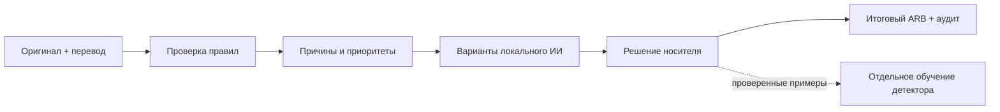

<div align="center">

# Qazaq Loc QA

**Проверка казахского перевода игры — с понятными причинами и вариантами исправления.**

Grand Mobile × Decentrathon 6.0 · Кейс 02

[](presentation.html)

### [▶ Посмотреть презентацию](presentation.html)

[Как открыть проект](#как-открыть-проект) · [Проверить свои файлы](#проверить-свои-файлы) · [Подключить ИИ](#подключить-ии-переводчик) · [Результаты](#результаты) · [Расходы](#расходы) · [План развития](#план-развития)

</div>

## Что делает программа

Вы даёте программе русский оригинал и казахский перевод интерфейса. Она показывает подозрительные строки, объясняет причину и, если подключён переводчик, предлагает исправления. Человек проверяет варианты, после чего программа собирает итоговый файл.

**Для кого:** разработчики и команды локализации, которым нужно проверить тысячи строк, даже если они сами не знают казахский.

**Что такое ARB:** файл со списком текстов интерфейса. У каждой строки есть имя — ключ. Записи вроде `{name}` — переменные: во время игры на их место подставляются имя, число или другое значение. При переводе их нужно сохранить.

## Как открыть проект

| Ваша задача | Что сделать | Что требуется |
|---|---|---|
| **Посмотреть презентацию** | Откройте [presentation.html](presentation.html) в браузере. В Windows можно дважды нажать [open_project.cmd](open_project.cmd). | Только браузер; работает без интернета. |
| **Проверить свои переводы** | Положите два ARB в `input`, запустите проверку по инструкции ниже. | Python 3.10+; модель необязательна. |
| **Получать новые предложения ИИ** | Установите локальный переводчик по [инструкции](INSTALL_AI.txt). | Интернет для установки, место для модели; автоматический запуск сейчас поддержан в Windows. |

**Если вы смотрите README на GitHub:** нажмите **Code → Download ZIP**, распакуйте архив и откройте `open_project.cmd` или `presentation.html`. GitHub показывает HTML и `.cmd` как код и не запускает их по нажатию. Отдельный сайт пока не опубликован.

В презентации работают кнопки разделов, переключение примеров и калькулятор расходов. Клавиши **← / →** переключают разделы, **F** включает полный экран. Анимации можно отключить.

## Проверить свои файлы

Все команды выполняются **из папки проекта**.

1. Установите Python 3.10+ и убедитесь, что команда `python --version` работает.
2. Положите в папку `input` **два файла**: `intl_ru.arb` — русский оригинал; `intl_kk.arb` — казахский перевод. На каждый язык должен быть один файл.
3. Для первого запуска **без генерации новых переводов ИИ** выполните в PowerShell:

```powershell
.\start_project.cmd --ai-limit 0
```

4. Откроется **`result/index.html`**. В нём все строки, фильтры, причины замечаний и сравнение «было → предложено». Входные файлы сохраняются.

В macOS/Linux техническая проверка запускается так; результат затем откройте в браузере:

```bash
python3 workflow.py --ai-limit 0
```

При отсутствии установленной модели проверка правил и HTML-отчёт доступны. Новые предложения ИИ появятся после установки переводчика. Если программа нашла прежние предложения для точно совпадающих строк, они могут отображаться и без нового запуска модели.

[Подробности входных файлов →](input/README.txt)

## Что будет в папке result

| Файл | Что внутри |
|---|---|
| **`index.html`** | Главный экран: все строки, фильтры, замечания и предложения. Начните с него. |
| `intl_kk_draft.arb` | Черновой перевод с предложенными изменениями. Нужна проверка смысла. |
| `intl_kk_fixed.arb` | Перевод, в который внесены **только одобренные человеком** изменения. Без одобрений он повторяет входной файл. |
| `selected_corrections.csv` | Таблица предложений для проверки и подтверждения. |
| `all_data.json`, `issues.json` | Все строки и найденные замечания для дальнейшей обработки. |
| `audit.json`, `draft_audit.json` | Технические проверки подтверждённого файла и черновика по отдельности. |

**Как подтвердить перевод:** откройте `result/selected_corrections.csv`, проверьте текст в `translation`, поставьте `reviewed_by_human=true` только у лично проверенных строк. Сохраните таблицу как `input/corrections.csv` и повторите запуск. Подробнее — в [руководстве](docs/usage.md).

## Подключить ИИ-переводчик

Этот шаг **необязателен** для проверки файлов. Для модели в Windows рекомендуется Python 3.11 или 3.12.

```powershell
python -m venv .venv
.venv\Scripts\python.exe -m pip install -r requirements-ai.txt
.venv\Scripts\python.exe setup_ai.py
.\start_project.cmd
```

Установка скачает зависимости и модель kazRush. После установки перевод запускается локально. По умолчанию обрабатывается **до 12 новых строк с замечаниями за запуск**, а не весь файл. Изменить лимит:

```powershell
.\start_project.cmd --ai-limit 50
```

Не для каждой строки будут варианты: генератор пропускает некоторые строки с переменными и разметкой. Предложение модели всегда остаётся черновиком до проверки человеком. Автоматический запуск переводчика через `.cmd` сейчас рассчитан на Windows.

[Установка модели →](INSTALL_AI.txt) · [Экспериментальный переводчик Qwen →](docs/qwen_glossary.md)

## Попробовать без своих данных

Примеры в `examples/demo` вымышлены и не содержат выгрузку организатора. Нужен только Python.

```bash
python locqa.py check --source examples/demo/intl_ru.arb --target examples/demo/intl_kk.arb --glossary examples/demo/glossary.csv --suspect-phrases examples/demo/suspect_kk.txt --out reports/demo.json
python examples/demo/verify.py
```

Откройте `reports/demo.html`. Ожидаются **11 специально внесённых замечаний**. Это демонстрация работы правил, а не точность на новых переводах.

В Windows [check_project.cmd](check_project.cmd) запускает тесты, создаёт и открывает этот отчёт. [Разбор примеров →](examples/demo/README.md)

## Что уже работает

- Проверка отсутствующих переводов, переменных, форм числа, отдельных языковых ошибок, терминов и длины текста — **11 типов замечаний**.
- Общий запуск `input → start_project.cmd → result`, таблица всех строк и сохранение оригиналов.
- До трёх предложений на строку из доступных генераторов; варианты могут отсутствовать или требовать исправления.
- Раздельная сборка черновика и подтверждённого перевода, технический аудит.
- Код обучения детектора на принятых носителями примерах. Обучение и его оценка запускаются отдельно от обычной проверки.

**Границы:** правила не гарантируют понимание игрового сленга и идиом. Проверка длины не измеряет реальную ширину кнопки. Технически корректный ответ ИИ может быть неверным по смыслу. Узбекский поддерживается общими техническими проверками; языковые правила требуют отдельной адаптации.

[Архитектура и границы каждого компонента →](docs/architecture.md)

## Результаты

**Снимок локальной подготовки на 31 октября 2026.** Объём работы и качество перевода — разные показатели.

| Показатель | Результат |
|---|---|
| Русский набор кейса | **5 479** строковых ключей. |
| Очередь проверки | **139** строк. |
| Кандидаты игрового словаря | **88** терминов; требуют согласования. |
| Предложения kazRush | Для **105 из 139** строк. |
| Ответы Qwen | **135 из 139** прошли проверку переменных, тегов и чисел; **4** отклонены. Это не оценка смысловой точности. |
| Текущий черновик `result/intl_kk_draft.arb` | **134** изменения; **0** подтверждены человеком. Проверка не нашла пустых переводов и нарушений переменных/форм числа. |
| Подтверждённый файл `result/intl_kk_fixed.arb` | **0** одобренных изменений: пока сохраняет входной перевод. Аудит показывает **16** отсутствующих/пустых переводов и **12** несовпадений переменных. |
| Проверка кода | **37 тестов проходят локально**. GitHub Actions подготовлен для Windows и Ubuntu. |

Точность находок, доля обнаруженных скрытых ошибок и естественность исправлений **ещё не измерены на независимой выборке**. Финальный перевод для сдачи требует одобрения носителей и проверки Flutter. У трёх исходных имён ключей есть ограничения — см. [проверку Flutter](docs/usage.md#проверка).

[Методика оценки →](docs/evaluation.md)

## Как устроено



Поиск ошибок и предложение перевода разделены, чтобы оценивать их независимо. Проверенные решения пополняют данные для обучения. Модель не может сама присвоить своему ответу отметку «проверено человеком».

## Расходы

- **Известно:** внешние LLM API в зафиксированном запуске не использовались — **0 ₸**. Локальная презентация не требует платного хостинга.
- **Ещё не посчитано:** время команды и носителей, электричество, интернет, оборудование, подписки и другие платежи.
- **Будущие расходы:** сервер, сопровождение и дополнительные проверки — после выбора нагрузки и способа внедрения.

В [презентации](presentation.html#costs) есть калькулятор. Его начальные значения — **условный пример**, а не цена проекта. Введите свои часы и ставки и учитывайте все суммы за один выбранный период.

## План развития

| Этап | Статус и следующий результат |
|---|---|
| Техническое ядро и общий запуск | **Готовы:** проверки, HTML, два ARB, аудит и публичное демо. |
| Проверенные переводы | **Далее:** носители принимают исправления и словарь; появляется надёжный набор примеров. |
| Независимая оценка | Измерить, сколько ошибок найдено, сколько находок верны и какие переводы действительно лучше. |
| Проверка смысла и улучшение перевода | Развивать работу с идиомами и сленгом; получать игровой, нейтральный и короткий варианты. |
| Внедрение в команду | Дообучение на принятых предложениях, проверка ARB при изменениях кода и адаптация к другим языкам. |

Даты будущих этапов зависят от разметки, ресурсов и результатов испытаний. [Анимированный план →](presentation.html#roadmap)

## Документация и код

| Ссылка | Назначение |
|---|---|
| [Руководство](docs/usage.md) | Подробные команды, таблицы проверки и Flutter. |
| [Архитектура](docs/architecture.md), [требования](AI_REQUIREMENTS.md) | Устройство системы и правила обучения. |
| [Оценка](docs/evaluation.md), [сценарий защиты](docs/pitch.md) | Доказательства и подача проекта. |
| [workflow.py](workflow.py), [locqa.py](locqa.py) | Общий запуск и технические проверки. |
| [proposal_loader.py](proposal_loader.py), [kazrush_proposals.py](kazrush_proposals.py) | Подбор и генерация вариантов. |
| [learn_detector.py](learn_detector.py), [tests/](tests/) | Обучение детектора и проверки кода. |

Проверить код:

```bash
python -m unittest discover -s tests -v
```

## Модели и данные

Веса скачиваются отдельно. Для [kazRush](https://huggingface.co/deepvk/kazRush-ru-kk) в карточке указана Apache 2.0; для исследовательского [NLLB](https://huggingface.co/facebook/nllb-200-distilled-600M) — CC BY-NC 4.0. Лицензии весов не определяют лицензию кода этого репозитория. [Qwen с игровым словарём](docs/qwen_glossary.md) — отдельный экспериментальный генератор.

Исходные выгрузки, приватные примеры, модели и результаты запуска исключены из Git. Публичное демо содержит вымышленные строки. По условиям кейса данные используются только для конкурса и удаляются в течение 14 дней после объявления победителей, если не заключено отдельное соглашение.

Основание: [описание кейса Grand Mobile × Decentrathon 6.0](https://docs.google.com/document/d/14gDrXuh0mVUSUjCKfF7_GmFLNbvrEMDQiA4diA4-EcI/preview).
